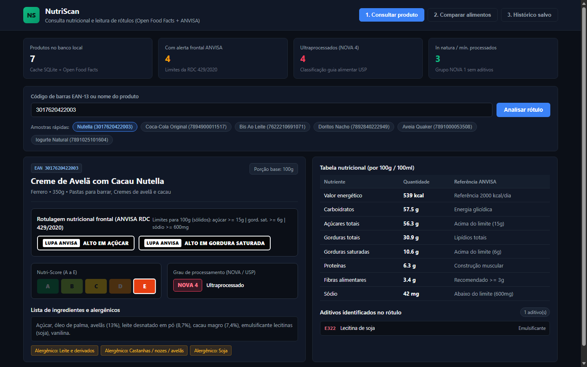
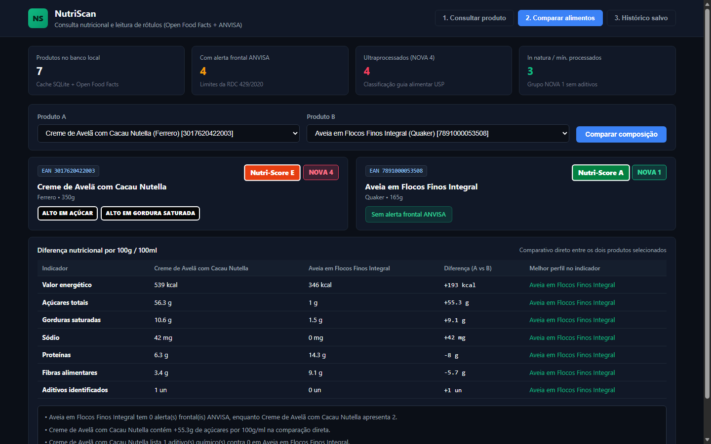
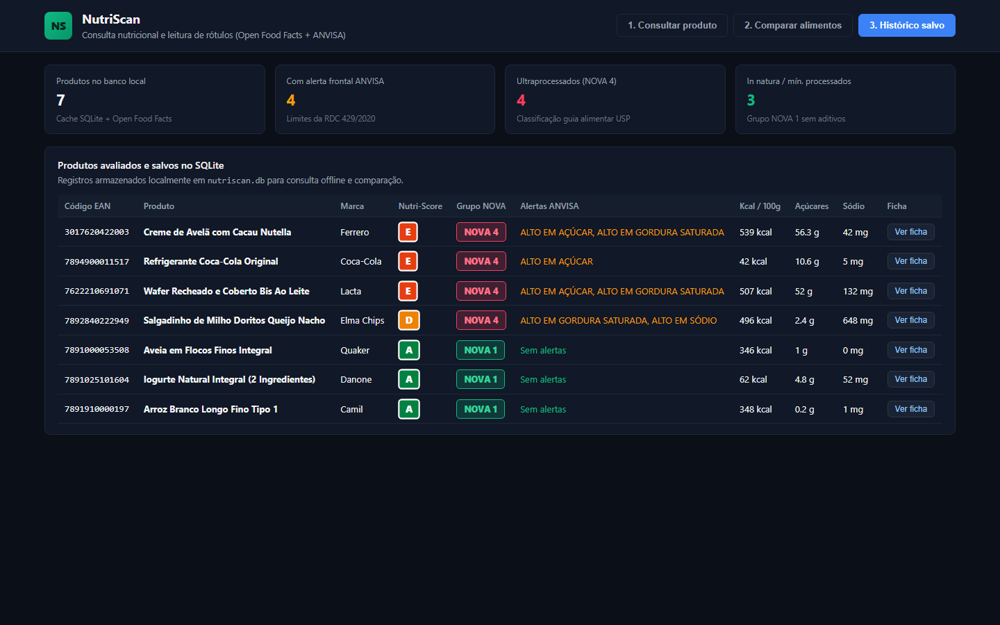
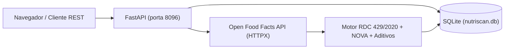

# NutriScan

Aplicação web e API REST em Python para consulta nutricional de alimentos por código de barras (EAN-13) ou busca textual. O serviço consulta a base aberta [Open Food Facts](https://world.openfoodfacts.org/), verifica os limites de rotulagem nutricional frontal da **ANVISA (RDC 429/2020 e IN 75/2020)**, exibe o grau de processamento **NOVA (1 a 4)** e o **Nutri-Score (A a E)**, traduz códigos de aditivos (`E322`, `E150d`, `E338`, `E621`) e armazena os produtos consultados no SQLite.

## Painel web

### 1. Consulta de produto e leitura de rótulo
Exibe os alertas frontais no padrão de lupa da ANVISA (`ALTO EM AÇÚCAR`, `ALTO EM GORDURA SATURADA`, `ALTO EM SÓDIO`), a letra do Nutri-Score, o grupo NOVA segundo o guia alimentar da USP, a tabela por 100g/100ml e a lista de aditivos e alergênicos identificados.



### 2. Comparador de alimentos
Compara dois produtos lado a lado por 100g ou 100ml e calcula a diferença exata de calorias, açúcares totais, gorduras saturadas, sódio, proteínas, fibras alimentares e número de aditivos químicos.



### 3. Histórico salvo no SQLite
Lista os produtos já analisados e gravados na tabela `products_history` (`nutriscan.db`), permitindo reabrir qualquer ficha nutricional sem nova chamada externa.



## Critérios de avaliação nutricional

### Rotulagem frontal ANVISA (RDC 429/2020 e IN 75/2020)

| Nutriente | Limite para sólidos (por 100g) | Limite para líquidos (por 100ml) | Selo gerado |
| :--- | :--- | :--- | :--- |
| Açúcares adicionados / totais | `>= 15 g` | `>= 7,5 g` | `ALTO EM AÇÚCAR` |
| Gorduras saturadas | `>= 6 g` | `>= 3 g` | `ALTO EM GORDURA SATURADA` |
| Sódio | `>= 600 mg` | `>= 300 mg` | `ALTO EM SÓDIO` |

### Classificação NOVA (NUPENS / USP)
- **NOVA 1**: In natura ou minimamente processado (ex: aveia em flocos, arroz, iogurte natural sem aditivos).
- **NOVA 2**: Ingrediente culinário processado (ex: óleos vegetais, manteiga, sal, açúcar).
- **NOVA 3**: Alimento processado (ex: conservas, queijos, pães simples).
- **NOVA 4**: Ultraprocessado (formulações industriais com corantes, emulsificantes, edulcorantes ou realçadores de sabor).

## API pública utilizada

O projeto consome a API aberta do [Open Food Facts](https://world.openfoodfacts.org/data), listada no diretório [public-apis](https://github.com/public-apis/public-apis), sem necessidade de chave de autenticação:

| Operação | Endpoint externo | Uso no NutriScan |
| :--- | :--- | :--- |
| Busca por código EAN | `world.openfoodfacts.org/api/v2/product/{barcode}.json` | Obtém tabela nutricional por 100g/ml, lista de ingredientes, tags de alergênicos, aditivos (`additives_tags`), grupo NOVA e Nutri-Score. |
| Busca textual | `br.openfoodfacts.org/cgi/search.pl` | Pesquisa alimentos comercializados no Brasil por nome ou marca. |

## Arquitetura



## Endpoints da API REST

- `GET /api/v1/health`: estado do serviço e normas suportadas.
- `GET /api/v1/metrics`: total de produtos no cache, contagem de ultraprocessados (NOVA 4), produtos com alerta ANVISA e distribuição por letra do Nutri-Score.
- `GET /api/v1/product/{barcode}`: analisa um produto pelo código EAN-13 e salva no SQLite.
- `GET /api/v1/search?q={termo}`: pesquisa produtos por nome, marca ou código de barras.
- `GET /api/v1/compare?barcode_a={ean1}&barcode_b={ean2}`: compara dois produtos lado a lado.
- `GET /api/v1/history`: retorna os produtos armazenados no banco local.

## Como executar

### Execução local

```bash
git clone https://github.com/Glawther/NutriScan.git
cd NutriScan

python -m venv .venv
# Windows
.venv\Scripts\activate
# Linux/macOS
source .venv/bin/activate

pip install -r requirements.txt
python main.py
```

Acesse `http://127.0.0.1:8096` no navegador. A documentação interativa OpenAPI fica em `http://127.0.0.1:8096/docs`.

### Docker Compose

```bash
docker compose up --build -d
```

## Testes

```bash
pytest tests/ -v
```

## Licença

MIT.
