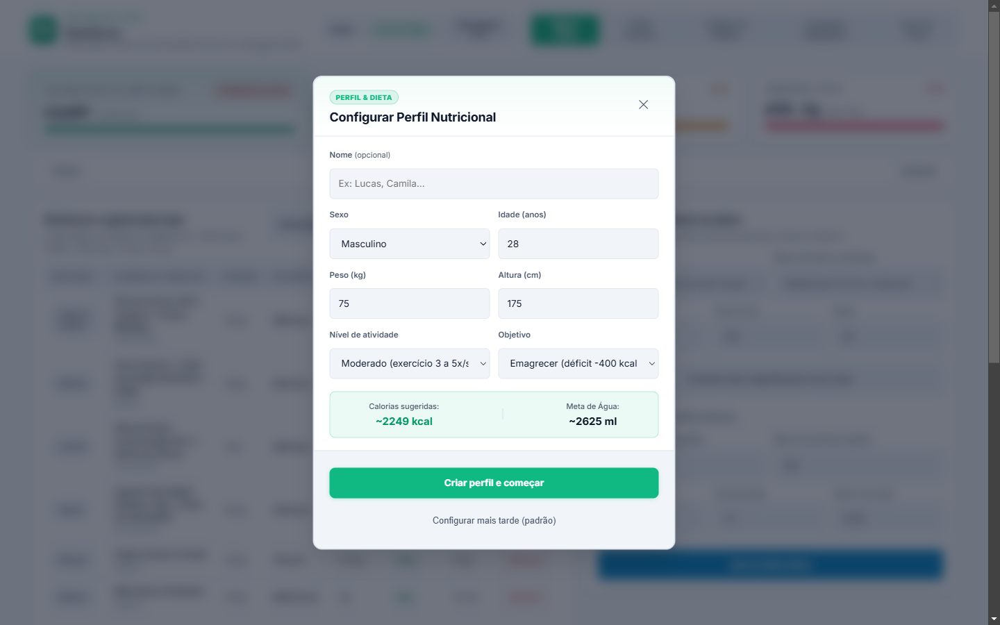
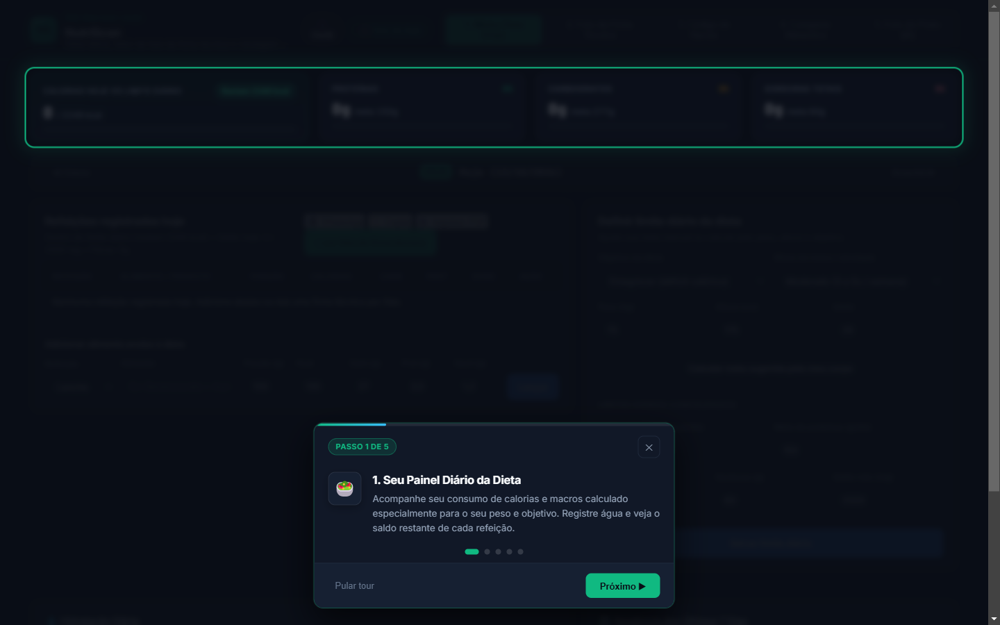
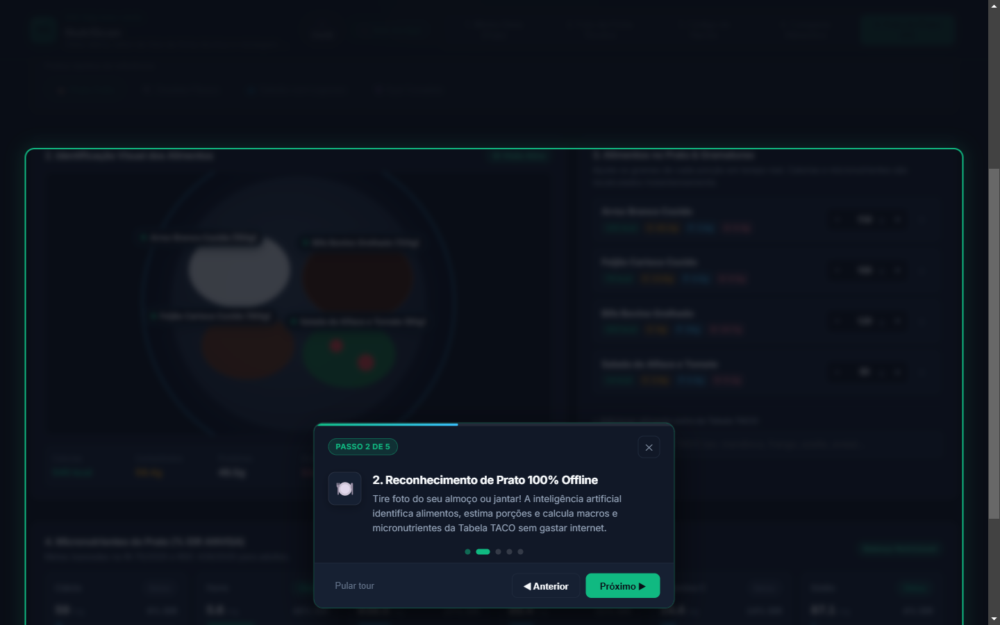
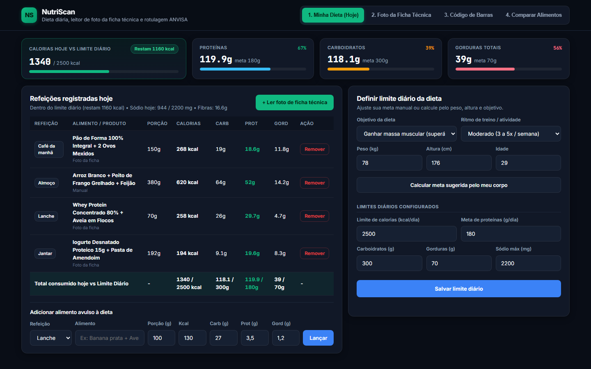
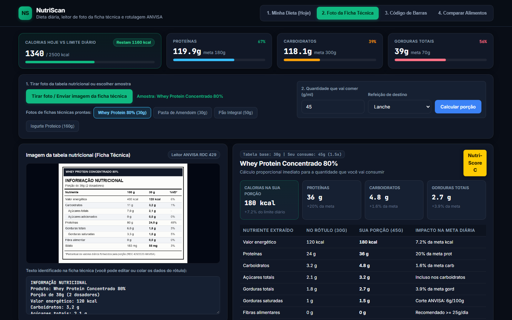
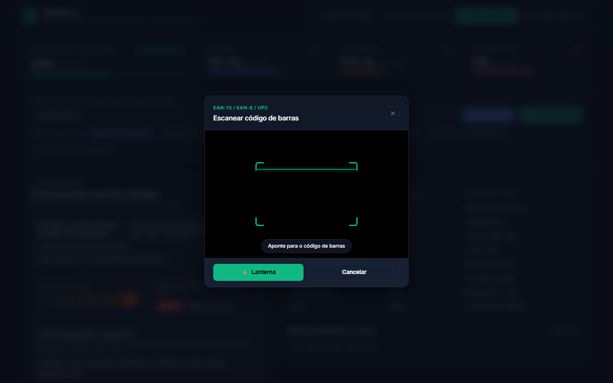
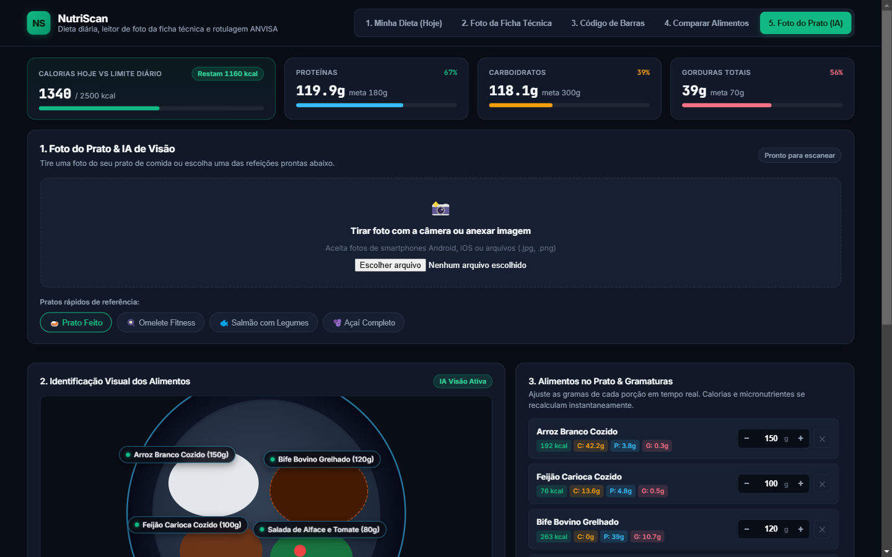
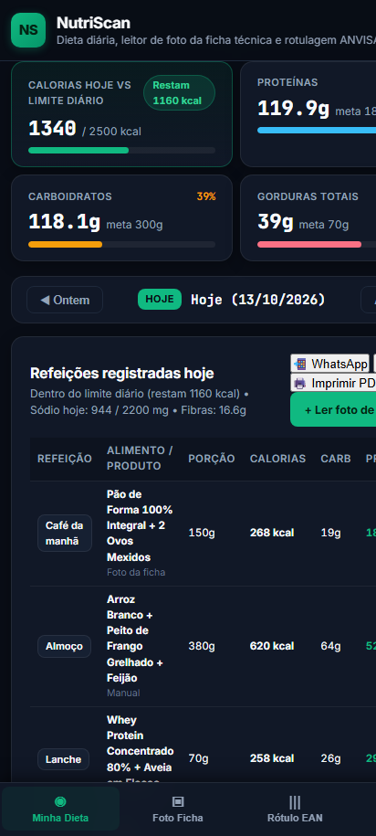
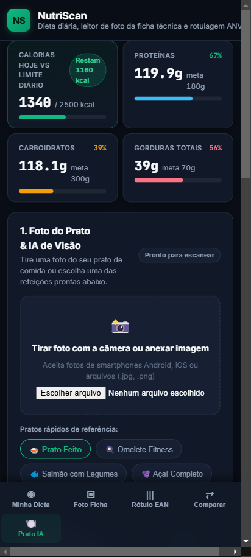

# NutriScan

Aplicativo e API em Python para acompanhamento de dieta, leitura de foto de tabelas nutricionais (fichas técnicas), consulta por código de barras (EAN-13) e verificação dos limites de rotulagem frontal da ANVISA (RDC 429/2020 e IN 75/2020). Inclui projeto Android nativo em Kotlin com build automático de APK no GitHub Actions.

## Funcionalidades

### 1. Perfil Inicial Personalizado e Estado Zerado
No primeiro acesso (ou pelo botão `👤 Perfil`), o app oferece um assistente de criação de perfil que calcula as metas com precisão via Mifflin-St Jeor (TMB + Fator de Atividade) de acordo com o sexo, idade, altura, peso e objetivo (Emagrecer, Manter ou Ganhar Massa):
- **Início 100% limpo:** perfil começa com 0 refeições e 0 ml de água para registrar o dia do zero sem dados fictícios.
- **Metas sob medida:** define metas de calorias, água (35 ml/kg) e macros (proteína, gordura e carboidratos).
- **Recálculo e redefinição rápida:** é possível redefinir dados diários ou atualizar medidas a qualquer momento.

<p align="center">
  
  &nbsp;&nbsp;&nbsp;&nbsp;
  
</p>

### 2. Tour Guiado Interativo pelo App
Para orientar quem está usando o app pela primeira vez, o assistente inclui um tour interativo de 5 passos com efeito spotlight (destaque escurecido com foco visual), transição automática de abas e feedback tátil (vibração háptica):
1. **Minha Dieta:** visão geral do saldo de calorias, macros e água.
2. **Foto do Prato com IA:** identificação de refeições por visão computacional offline.
3. **Foto da Ficha Técnica:** leitura de tabelas nutricionais em embalagens.
4. **Código de Barras:** leitura em tempo real por câmera com selos da ANVISA.
5. **Exportação:** envio direto do relatório alimentar para o WhatsApp do nutricionista.

<p align="center">
  
  &nbsp;&nbsp;&nbsp;&nbsp;
  
</p>

### 3. Minha Dieta, Hidratação e Tendências
Painel diário com barra de progresso para meta de calorias (kcal) e macronutrientes (carboidratos, proteínas, gorduras totais e sódio). Inclui:
- **Navegador de datas:** navegue por dias anteriores e futuros com um clique.
- **Controle de hidratação:** cálculo diário de água (35 ml por kg de peso corporal) com botões rápidos de registro (`+200ml`, `+300ml`, `+500ml`).
- **Tendência dos últimos 7 dias:** gráfico com histórico calórico e taxa de conformidade com a meta.
- **Exportação para nutricionista:** botão de compartilhamento formatado para WhatsApp, cópia para área de transferência e impressão em PDF.



### 4. Leitor de Foto da Ficha Técnica (Tabela Nutricional)
Permite tirar foto da tabela nutricional com a câmera do celular ou carregar imagem do rótulo. O extrator identifica porção-base, valor energético, carboidratos, proteínas, gorduras totais, gorduras saturadas, fibras e sódio, calculando os valores proporcionais exatos para a quantidade consumida (em gramas ou ml) e o impacto percentual na meta diária.



### 5. Código de Barras (Câmera ao Vivo e Consulta EAN-13)
Leitor de código de barras integrado com suporte à API nativa `BarcodeDetector` da câmera do celular (com retículo visual, laser de escaneamento e lanterna), além de consulta à base aberta [Open Food Facts](https://world.openfoodfacts.org/) para obter dados nutricionais por código EAN-13, classificação NOVA (1 a 4), Nutri-Score (A a E) e selos de rotulagem frontal da ANVISA:

- **ALTO EM AÇÚCAR**: `>= 15 g` em sólidos ou `>= 7,5 g` em líquidos por 100g/100ml.
- **ALTO EM GORDURA SATURADA**: `>= 6 g` em sólidos ou `>= 3 g` em líquidos por 100g/100ml.
- **ALTO EM SÓDIO**: `>= 600 mg` em sólidos ou `>= 300 mg` em líquidos por 100g/100ml.




### 6. Foto do Prato com IA de Visão Computacional (100% Offline)
Permite tirar foto do prato de comida ou selecionar exemplos pré-configurados. Um motor de visão computacional local analisa a área do prato, identifica os agrupamentos de cores (folhosos, feijão, arroz, proteínas grelhadas, tubérculos) e estima as gramaturas com base na tabela TACO (UNICAMP), sem nenhuma dependência de APIs externas pagas:
- **Ajuste interativo de porções:** botões `[ - ] [ 150 ] g [ + ]` recalculam instantaneamente calorias e nutrientes.
- **Painel de Micronutrientes (IDR ANVISA):** barras comparativas com as metas oficiais de Cálcio, Ferro, Potássio, Magnésio, Vitamina C e limite de Sódio.
- **Lançamento em 1 clique:** adiciona todos os alimentos identificados diretamente à refeição do diário.



### 7. Versão Mobile e Aplicativo Android (.APK)
Interface responsiva em formato Bento com barra inferior de navegação e suporte a PWA. A pasta `android/` contém um projeto nativo em Kotlin/WebView com:
- **Splash Screen nativa:** inicialização instantânea no tema escuro `#090d16` sem tela em branco.
- **Feedback tátil:** vibração háptica nativa ao escanear códigos e registrar refeições via `NativeBridge`.
- **Câmera integrada:** suporte nativo a captura de foto e galeria.
- **Build automático de APK:** compilação automática de `app-debug.apk` e APK de Release no GitHub Actions.

<p align="center">
  
  &nbsp;&nbsp;&nbsp;&nbsp;
  
</p>

## Como baixar o APK para Android

O fluxo do GitHub Actions (`.github/workflows/android-apk.yml`) compila os APKs automaticamente em cada release e push.

1. Acesse a aba **Releases** no repositório [Glawther/NutriScan](https://github.com/Glawther/NutriScan/releases).
2. Baixe o arquivo `app-debug.apk` ou `NutriScan-v1.6.3.apk`.
3. Instale diretamente no celular Android (habilite a instalação de fontes confiáveis nas configurações do aparelho).

## Como executar localmente

```bash
git clone https://github.com/Glawther/NutriScan.git
cd NutriScan

python -m venv .venv
# Windows
.venv\Scripts\activate
# Linux/macOS
source .venv/bin/activate

pip install -r requirements.txt
python main.py
```

Acesse `http://127.0.0.1:8096` no navegador. A documentação OpenAPI fica em `http://127.0.0.1:8096/docs`.

## Testes

```bash
# Testes da API, visão computacional e regras nutricionais (Python)
pytest tests/ -v

# Testes dos parsers, câmera, estimador de prato, perfil e tour (JavaScript)
node --test tests/js/*.test.js
```

## Licença

MIT.

